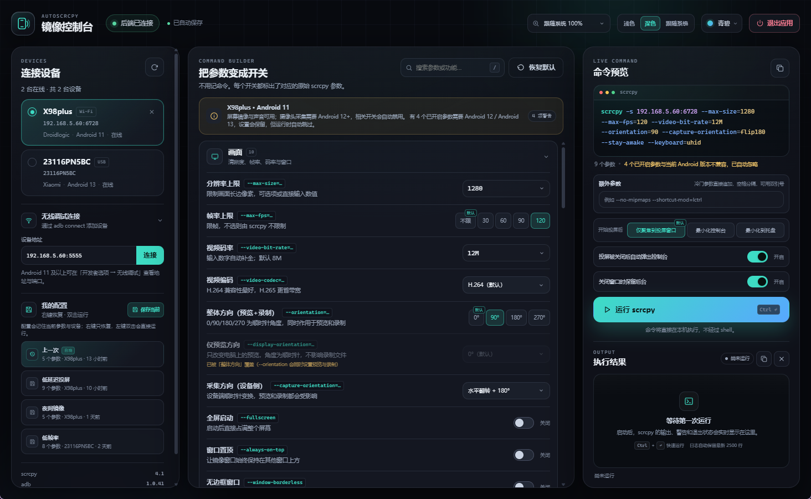
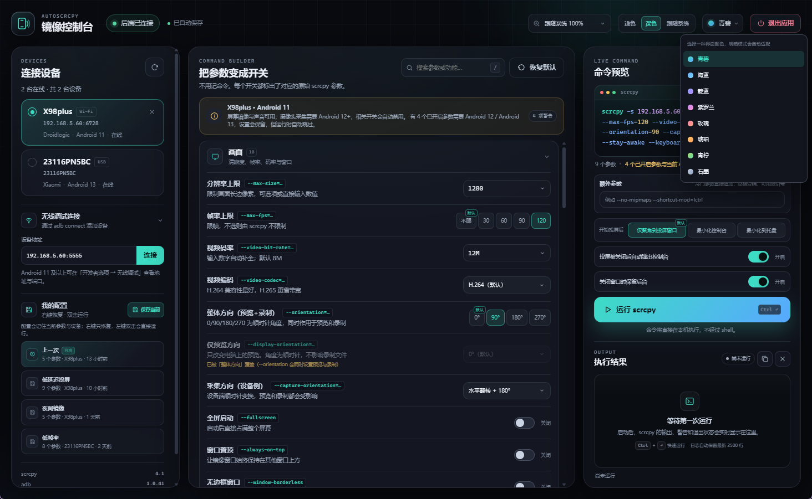
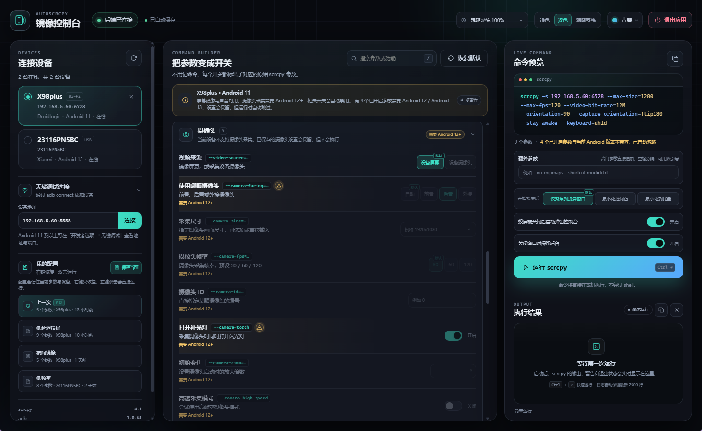
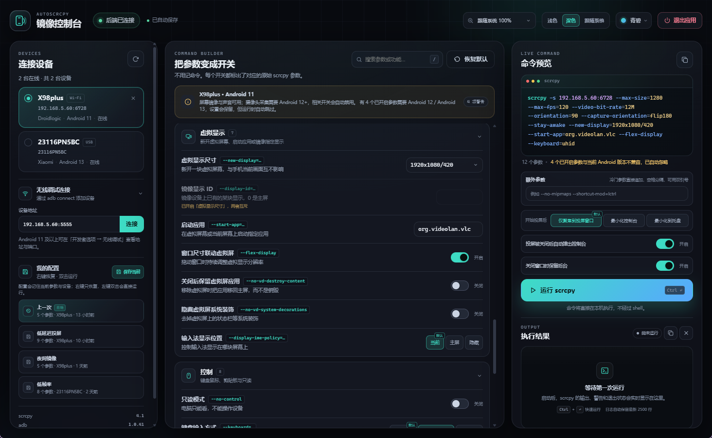
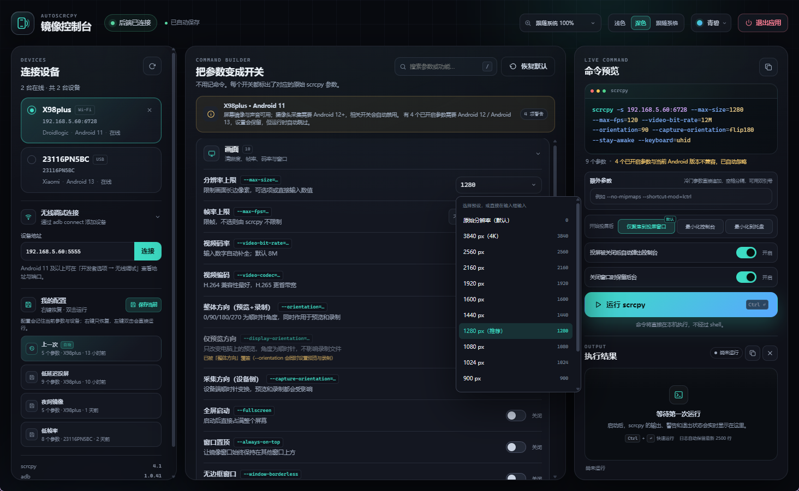
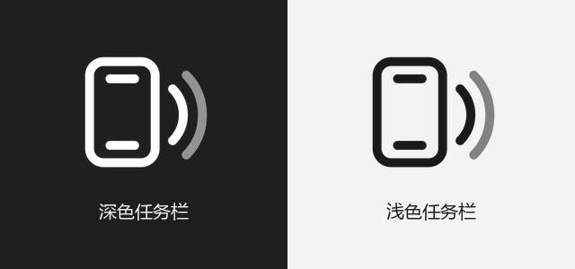
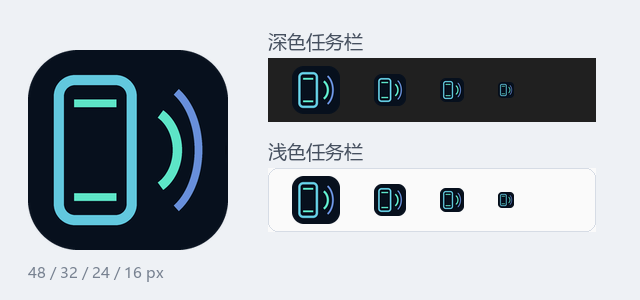
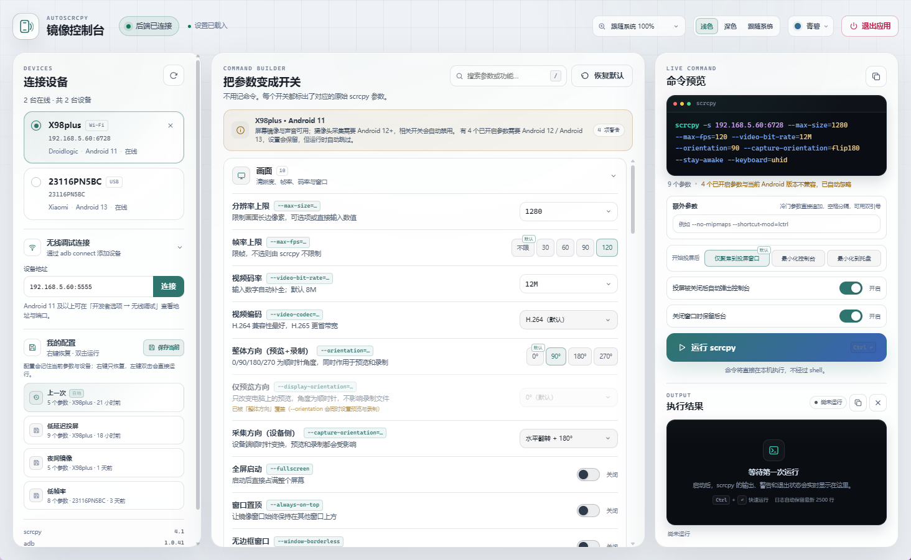
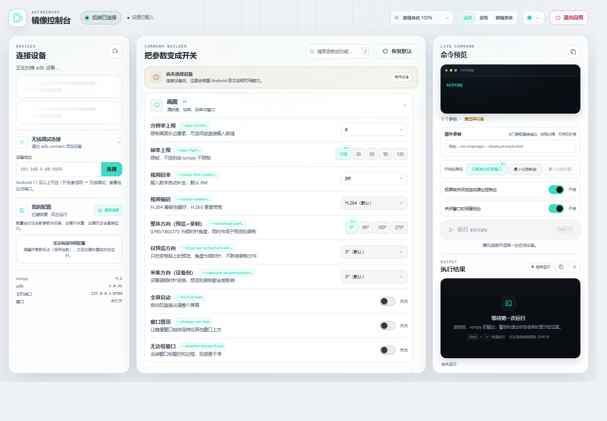
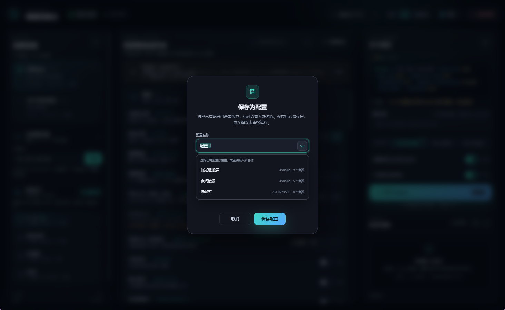

# AutoScrcpy

> 当前版本 **2.1.2** · 面向 Windows 10/11 · 需要 Python 3.10+

把 scrcpy 的命令行参数变成一眼能看懂的开关。Python 只在本机做后端；界面是一套可以直接编辑的 HTML/CSS/JS，从 2.0 起默认运行在**程序自带的 WebView2 窗口**里，而不是另开一个无头浏览器。支持浅色/深色/跟随系统与 8 种强调色。



> 截图拍摄于 2.1.0 版，其中设备信息为演示数据；实际界面会根据已连接的 adb 设备显示。

## 快速开始

1. 确认 Python 3.10+、`scrcpy`、`adb` 都在 PATH 中（见下方「环境要求」）。
2. 如未安装 Python 依赖，双击 `install-dependencies.bat`，或执行：

   ```bat
   python -m pip install -r requirements.txt
   ```

3. 双击 **`launch.pyw`**。Explorer 会用 `pythonw.exe` 运行它，它再用 `subprocess.Popen` + `CREATE_NO_WINDOW` 启动后端；后端随后打开一个原生 WebView2 窗口，通知区域出现 AutoScrcpy 图标。
4. 选择设备，调整开关，点击「运行 scrcpy」。

需要看完整错误时，双击 `start-debug.bat`，它会在控制台里启动后端。

> `launch.pyw` 依赖 `.pyw` 的打开方式（python.org 安装包通常关联到 `pyw.exe`）。如果双击后被编辑器打开，右键选择「打开方式」→「Python」，或直接运行 `start-debug.bat` 排查。

## 环境要求

| 组件 | 要求 |
|---|---|
| 系统 | Windows 10/11 |
| Python | 3.10 或更高 |
| Python 依赖 | `websockets>=15,<17`，见 `requirements.txt` |
| 窗口 | 推荐 **Microsoft Edge WebView2 运行时**（Windows 11 自带；Windows 10 安装过 Edge 一般也有）。缺失时自动回退到 Edge/Chrome 应用窗口 |
| scrcpy | 以 v4.1 为基准；旧版本也能启动，界面会按 `scrcpy --help` 隐藏不支持的参数 |
| adb | 与 scrcpy 同目录，或已在 PATH 中 |

`scrcpy` 和 `adb` 的版本、本机端口和当前窗口类型显示在左栏底部；找不到 scrcpy 时运行按钮不可用，找不到 adb 时设备列表会报错。

### 为什么改用 WebView2

1.x 使用 `msedge --app=...` 打开界面。这个窗口属于 Edge 进程，Windows 11 的「重启后自动恢复应用」会把 Edge 连同这个窗口一起恢复；此时 AutoScrcpy 后端并没有启动，于是只剩一个空白窗口。

2.0 把同一套界面放进程序自己的 WebView2 窗口：

- 不再启动独立的 Edge/Chrome 进程，Windows 不会在登录后恢复出一个没有后端的窗口；
- 窗口的关闭按钮可以被程序接管（见「关闭窗口时保留后台」）；收进托盘时会停止整个 WebView2 前端以节省资源；
- WebView2 资源随后端进程一起退出，不会残留后台页签。

WebView2 由 Edge 运行时提供（`msedgewebview2.exe`），界面仍然通过 `http://127.0.0.1:<端口>` 加载，和浏览器模式完全同一套代码。仓库自带 `assets/webview2/WebView2Loader-*.dll`（x64 / x86 / arm64），不需要 .NET 或 `pywebview`。

## 界面速览

- **左栏**：设备发现、无线调试连接、命名配置，以及 scrcpy/adb 版本、本机端口和窗口类型。
- **中栏**：参数搜索、八个参数组、恢复默认。
- **右栏**：实时命令、额外参数、开始投屏后行为、两个窗口开关、运行/重启/停止、执行日志。



## 已实现的功能

- **运行环境自检**：启动时读取 `scrcpy --version`、`scrcpy --help` 和 `adb version`；当前 scrcpy 不支持的开关会置灰。
- **设备发现**：调用 `adb devices -l`，显示在线、离线、未授权设备，并补全 Android 版本、API、厂商、型号和无线/USB 类型。
- **无线连接**：界面内输入 `IP:端口` 执行 `adb connect`，无线设备可以单独断开。
- **参数翻译**：**62 个**常用 scrcpy 开关，分为画面、设备行为、声音、摄像头、虚拟显示、控制、录制与后台、高级。
  - 每个开关显示原始参数，例如 `--stay-awake`、`--max-fps=…`。
  - 小字是简短说明；悬停参数名或参数值（如 `--max-fps=…`）显示完整解释。
  - **默认值不生成参数**：官方默认值标记为「默认」，即使手动选中或输入该值，也不会添加对应参数。
  - **可选择可输入**：分辨率、视频/音频码率、摄像头尺寸、虚拟显示尺寸使用自绘预设菜单，也可直接输入。
  - **统一下拉外观**：所有参数下拉、顶栏缩放和颜色选择都使用同一套自绘菜单。
  - **少量选项用按钮**：4 个及以下选项的单选参数使用横向切换按钮，默认项带「默认」角标。
  - **参数搜索**：按标题、原始参数、简短说明、完整解释和选项文字过滤。
  - **分组折叠**：点击组标题折叠或展开，默认折叠「高级」和「录制与后台」，状态会保存。
- **按设备与工具能力自动限制**：
  - `scrcpy --help` 中不存在的参数会置灰。
  - 摄像头采集需要 Android 12+；音频转发需要 Android 11+；`--audio-source=playback` 和 `--audio-dup` 需要 Android 13+；虚拟显示需要 Android 10+。
  - 不兼容的选项会自动禁用；已经打开的开关会保留状态、显示黄色警告图标，本次命令自动跳过。

  
- **虚拟显示**：`--new-display`、`--display-id`、`--start-app`、`--flex-display`、`--no-vd-destroy-content`、`--no-vd-system-decorations`、`--display-ime-policy`，详见「虚拟显示」。
- **额外参数**：右栏「额外参数」输入框可以追加任意冷门参数，支持空格分隔和双引号；格式错误会提示并阻止运行，详见「额外参数」。
- **命名配置**：点「保存当前」为当前参数与设备命名保存，最多 100 个；名称输入框支持选择已有配置覆盖；右键恢复、双击运行、卡片上有恢复/运行/删除按钮。
- **自动记录「上一次」**：每次 scrcpy 成功启动后，完整命令自动写入「上一次」配置，固定在列表顶部。
- **界面缩放**：顶栏组合框，默认「跟随系统」，预设 75%–250%（25% 步进），也可输入 70%–250%；高倍率自动切换两栏布局。
- **投屏后的窗口行为**：运行按钮上方三个横向按钮，默认「仅聚焦到投屏窗口」：仅聚焦 / 最小化控制台 / 最小化到托盘（停止界面）。
- **投屏被关闭后自动弹出控制台**：默认开启；投屏结束、被停止或异常退出后，会自动还原最小化或托盘中的控制台。
- **关闭窗口时保留后台**：右栏开关，决定点窗口 **×** 时收进托盘还是退出，并让右上角按钮在「退出应用」和「最小化到托盘」之间切换，详见「窗口、托盘与关闭行为」。
- **统一配色 + 明暗切换**：浅色 / 深色 / 跟随系统三个按钮，配合 8 种强调色（青碧、海蓝、靛蓝、紫罗兰、玫瑰、琥珀、青柠、石墨）；两种明暗共用同一套强调色（浅色下目前临时不做加深处理，正在评估可读性，见「配色与明暗」）。
- **托盘图标**：直接复用界面里的 `i-logo` 线条标志（手机 + 两道无线波，整体略向左偏移以取得视觉对称），随任务栏浅色/深色自动切换；单击/双击打开控制台，右键菜单提供「打开控制台」「停止投屏」「退出 AutoScrcpy」。
- **窗口 / 任务栏图标**：`assets/autoscrcpy.ico` 使用同一套对称规则：手机、听筒/底部指示条和两道波按整体墨迹居中，左右留白一致，16–256 px 九个尺寸共用一张主图；任务栏、Alt+Tab 与窗口标题栏显示的是同一版图标。
- **实时自动保存**：开关、颜色、设备、配置等修改立即写入 `settings.json`；文本输入 150ms 防抖，页面隐藏/关闭前强制保存。
- **实时命令预览**：完整 `scrcpy` 命令随开关即时更新，一键复制。
- **真实执行与日志**：后端直接以 argv 方式执行，不经过 shell；日志实时流式显示，展示退出码、耗时、停止状态，最多保留 2500 行。
- **运行中重启**：运行期间可停止旧进程并按当前参数重新启动。
- **双向生命周期**：前端断开后后端退出（保留后台时除外）；后端退出后前端显示提示；页面刷新会利用 3 秒宽限期重连；如果刷新时 scrcpy 正在运行，会恢复运行状态。
- **本地安全**：只绑定 `127.0.0.1`，WebSocket 校验 `Origin`；后端只接受以 `scrcpy` 开头的命令，拒绝 shell 执行。

## 虚拟显示



| 开关 | 原始参数 | 说明 |
|---|---|---|
| 虚拟显示尺寸 | `--new-display[=WxH][/DPI]` | 新开一块虚拟屏幕。留空表示镜像当前屏幕；可选「主屏尺寸与 DPI」或输入 `1920x1080`、`1920x1080/420`、`/240` |
| 镜像显示 ID | `--display-id=id` | 镜像设备上已有的某块显示（0 是主屏，填 0 不生成参数），可用 `scrcpy --list-displays` 查看 |
| 启动应用 | `--start-app=包名` | 在虚拟屏或当前屏上启动应用；`?` 前缀按名称匹配，`+` 前缀表示先强制停止 |
| 窗口尺寸联动虚拟屏 | `--flex-display` | 拖动窗口时持续调整虚拟显示分辨率，需要先开启虚拟显示 |
| 关闭后保留虚拟屏应用 | `--no-vd-destroy-content` | 关闭虚拟屏时把应用移回主屏，而不是销毁 |
| 隐藏虚拟屏系统装饰 | `--no-vd-system-decorations` | 不显示状态栏、导航栏等系统装饰 |
| 输入法显示位置 | `--display-ime-policy` | `local` 当前屏（默认）/ `fallback` 主屏 / `hide` 隐藏 |

注意：

- 虚拟显示需要 **Android 10+**；旧设备上整组相关开关会置灰。
- 「虚拟显示尺寸」和「镜像显示 ID」互斥，同时填写时后者的开关会禁用。
- 虚拟显示默认没有启动器；如果画面全黑，配合「启动应用」使用，例如 `--new-display=1920x1080 --start-app=org.videolan.vlc`。
- `--flex-display` 会把默认画面适配从「保持比例」改为「原始像素」，必要时请调整「画面适配方式」。
- 部分设备可能没有可用的虚拟显示实现，scrcpy 会直接报错；这是设备/系统限制，不是界面问题。

## 额外参数



右栏「额外参数」用于界面没有收录的冷门参数：

- 直接写在输入框里，按空格分隔，例如 `--no-mipmaps --shortcut-mod=lctrl`。
- 含空格的参数值用双引号或单引号包起来，例如 `--window-title="我的 手机"`；双引号内可用 `\"` 转义。
- 解析出的参数会追加到命令末尾，命令预览和「参数个数」会立即更新。
- 引号未闭合时输入框会变红并提示，运行按钮和 `Ctrl+Enter` 都会被禁用。
- 额外参数会随设置自动保存，也会写入命名配置和「上一次」，恢复配置时一起还原。
- 后端仍然只接受 `scrcpy` 作为第一个参数；额外参数只是普通 argv 项，不会被 shell 解释。

## 窗口、托盘与关闭行为



托盘图标直接使用界面左上角同款 `i-logo`（手机轮廓 + 听筒/底部指示条 + 两道无线波），整个组合按外接矩形居中，手机相对图标中心略微左移。Windows 任务栏为深色时使用白色线条，浅色时使用深色线条；系统切换明暗后会通过 `WM_SETTINGCHANGE` / `WM_THEMECHANGED` 立即换图，不需要重启。为适应托盘尺寸：16 px 省略听筒/底部细节，20–24 px 只保留一道波，32 px 起显示完整的两道波。

窗口和任务栏图标（`assets/autoscrcpy.ico`）也按同一规则重新排版：在圆角深色底上，手机、听筒/底部指示条与两道波作为一个整体按墨迹居中，左右各留约 12.5% 空白，最外侧的波不再贴住右边缘。16–256 px 的九个尺寸都由同一张主图缩放得到，因此任务栏、Alt+Tab 和窗口标题栏显示的是同一个平衡后的标志。



窗口右上角、靠近系统最小化/最大化/关闭按钮的位置有一个操作按钮，它的文字和图标由「关闭窗口时保留后台」决定：

| 「关闭窗口时保留后台」 | 点窗口 **×** | 右上角按钮 | 托盘 |
|---|---|---|---|
| **开启**（默认） | 收进托盘：**停止 WebView2 界面**，后端和投屏继续运行 | **退出应用**：停止投屏并彻底退出 | 单击/双击重建界面并打开 |
| **关闭** | 彻底退出 AutoScrcpy | **最小化到托盘**：停止界面，后端继续运行 | 单击/双击重建界面并打开 |

补充说明：

- **收进托盘会真正停止前端**：WebView2 窗口、渲染进程和页面全部销毁，只保留 Python 后端、adb/scrcpy 和托盘图标；这样不会留下一个后台网页持续占用内存。
- 从托盘重新打开时，后端会在同一端口重建 WebView2 窗口并重新加载页面；如果 scrcpy 仍在运行，会恢复“运行中”状态和停止/重启按钮（之前的日志面板已随前端销毁，重新打开后从新日志开始记录）。
- 在 WebView2 模式下，点 **×** 由后端原生拦截并决定“收进托盘”还是“退出”，不会留下一个空窗口。
- 浏览器回退模式（没有 WebView2）行为相同：开启「保留后台」时关闭浏览器但后端留在托盘；关闭时窗口和后端一起退出。
- 如果系统没有托盘图标（Explorer 未运行），「收进托盘」会自动回退为最小化窗口，避免后端失去入口。
- **资源管理器重启后图标会自动回来**：托盘窗口监听 Explorer 广播的 `TaskbarCreated` 消息，在任务栏重建后重新注册图标（并重试到新的通知区域可用为止），不需要重启 AutoScrcpy；后端、投屏和已收进托盘的界面状态都不受影响。
- 该设置保存在 `settings.json` 的 `keepInBackground` 字段，和 `afterStart`、`autoOpenConsole` 一样属于全局界面行为，不随命名配置保存。
- 启动时若 Windows 恢复了旧的浏览器窗口（1.x 遗留），可以在任务栏关闭它；2.0 默认使用 WebView2，不会再产生新的空白窗口。

## 配色与明暗

2.0 不再提供「四套主题」，而是统一一套界面，由两个独立选项控制：

- **明暗**：顶栏颜色选择框左侧的三个横向按钮「浅色 / 深色 / 跟随系统」。默认跟随 Windows 的应用主题；切换后立即生效并保存到 `settings.json` 的 `appearance` 字段。
- **颜色**：下拉框提供青碧、海蓝、靛蓝、紫罗兰、玫瑰、琥珀、青柠、石墨，保存到 `accent` 字段。



浅色模式不是简单反色：

- 正文、次要文字、禁用项和提示文字使用更深的灰阶，保证白底上的可读性。
- 8 种强调色目前**临时**沿用深色模式的明亮变体（浅色下不再加深），用于评估白底上的可读性；原来的加深变体（例如青碧 `#2f756e`、琥珀 `#a85f26`、青柠 `#5b7a2a`）仍保留在 `app.css` / `app.js` 中，随时可以恢复。
- 命令预览和执行日志在两种模式下都保持深色代码面板，但命令行 token 会使用适合深色面板的亮色，避免“深色强调色写在深色代码块上看不清”。
- 窗口标题栏也会跟随明暗设置（WebView2 的 DWM 深/浅色标题栏）。
- 界面主体（按钮、标签、开关、面板文字）默认不可选中，避免拖动或点击时误选文字；命令行、执行日志、设备序列号和版本/端口仍可选中复制。

临时实验期间的浅色 + 青碧效果（上方 `screenshot-light.png` 仍是旧版加深配色）：



1.x 的 `theme` 设置会自动迁移：`midnight → 青碧`、`ember → 琥珀`、`paper → 石墨`、`terminal → 青柠`。

文字对比度也做了统一：弱化文字不再低到看不清，禁用项保持可读，日志里的错误/警告/成功分别使用红/黄/绿。

## 文件结构

```text
AutoScrcpy/
├─ app.py                     Python 后端（HTTP + WebSocket + adb/scrcpy 探测与执行）
├─ webview_host.py            ctypes 实现的 WebView2 原生窗口宿主
├─ win_tray.py                原生 Win32 托盘图标与窗口聚焦/最小化
├─ launch.pyw                 双击启动，隐藏后端控制台
├─ start-debug.bat            带控制台的调试启动
├─ install-dependencies.bat   安装 Python 依赖
├─ requirements.txt
├─ assets/
│  ├─ autoscrcpy.ico          程序窗口 / 任务栏图标（16–256 px，墨迹居中）
│  ├─ tray-dark.ico          深色任务栏用的白色线条托盘图标
│  ├─ tray-light.ico         浅色任务栏用的深色线条托盘图标
│  └─ webview2/
│     ├─ WebView2Loader-x64.dll
│     ├─ WebView2Loader-x86.dll
│     ├─ WebView2Loader-arm64.dll
│     └─ LICENSE-WebView2SDK.txt
├─ ui/
│  ├─ index.html              可直接编辑的前端结构
│  └─ assets/
│     ├─ app.css              统一配色（深/浅）、布局与动效
│     ├─ app.js               交互、参数目录、搜索与命令生成
│     ├─ theme-init.js        首帧前应用明暗/颜色，避免闪烁
│     └─ favicon.svg
├─ tests/
│  ├─ test_core.py             解析/设置/配置/命令白名单单元测试
│  ├─ test_after_start.py      投屏后聚焦/最小化/托盘行为单元测试
│  ├─ test_launcher.py         启动器命令行与无控制台逻辑单元测试
│  ├─ test_tray_icon.py       自适应托盘图标资源与主题选择单元测试
│  ├─ test_webview.py          WebView2 资源与窗口宿主状态单元测试
│  └─ test_smoke.py            HTTP + WebSocket + 自动退出集成测试
└─ docs/
   ├─ screenshot-main.png
   ├─ screenshot-light.png
   ├─ screenshot-colors.png
   ├─ screenshot-virtual.png
   ├─ screenshot-presets.png
   ├─ screenshot-profile-save.png
   ├─ screenshot-warnings.png
   ├─ tray-icon.png
   └─ window-icon.png
```

## 架构与生命周期

```text
┌──────────────────────────── 127.0.0.1:<随机空闲端口> ────────────────────────────┐
│                                                                                  │
│  WebView2 原生窗口（或回退：Edge/Chrome 应用窗口）     Python 后端               │
│  ui/index.html  ── HTTP 静态文件 ──►  websockets.process_request                 │
│       │                                                                          │
│       └──────────── WebSocket /ws ─────────────►  scrcpy / adb 子进程             │
│                                                                                  │
└──────────────────────────────────────────────────────────────────────────────────┘
```

- 启动时先用 `bind(("127.0.0.1", 0))` 取得空闲端口，再把 socket 交给 WebSocket 服务器，避免端口竞态。
- 启动时执行 `scrcpy --version`、`scrcpy --help` 和 `adb version`，把版本与参数表随 `hello` 消息发给前端。
- 同一个端口既提供 HTML/CSS/JS，也提供 `/ws`，前端不需要处理跨域或 `file://` 限制。
- 前端生成完整 scrcpy argv；后端检查首项必须是 `scrcpy`，再通过 `subprocess.Popen` 直接启动，不经过 shell。
- **WebView2 宿主**：`webview_host.py` 在独立 STA 线程里创建 Win32 窗口和 WebView2（`ICoreWebView2Controller`），主线程继续跑 asyncio。窗口尺寸变化、显示/隐藏、关闭请求通过动作队列 + `PostMessage` 投递，COM 调用在消息回调返回后执行，避免 ctypes 重入问题。
- WebView2 不可用时，`open_main_window` 自动回退到 `msedge --app=...` / `chrome --app=...`，其余逻辑不变。
- 前后端通过 WebSocket 心跳保持连接。前端断开超过 3 秒后端退出；第一次启动 90 秒内没有前端连接也会退出。
- 「最小化到托盘」会停止并销毁 WebView2 前端（窗口与渲染进程），只保留 HTTP/WebSocket 服务、托盘和 scrcpy；从托盘重新打开时按需重建窗口，页面重新连接后恢复运行状态。
- `launch.pyw` 由 Explorer 通过 `.pyw` 关联交给 `pythonw.exe`，再用 `subprocess.Popen(..., creationflags=CREATE_NO_WINDOW)` 启动 `app.py`；不使用 PowerShell 的 `-WindowStyle Hidden`，也不依赖 VBScript。
- 托盘图标由 `win_tray.py` 通过 `Shell_NotifyIconW` 创建，回调通过 `loop.call_soon_threadsafe` 投递回 asyncio 事件循环；图标按 `SystemUsesLightTheme` 在 `tray-dark.ico` / `tray-light.ico` 之间切换，并监听系统的明暗变化消息。托盘窗口还注册了 `TaskbarCreated`，Explorer 重启后自动重新添加图标。
- scrcpy 输出通过独立读取线程 + `asyncio.Queue` 送进事件循环。

## 运行中重启

- 重启会先停止当前进程，再按**当前界面参数**启动新进程；运行中修改的参数会立即用于新进程。
- 重启期间「重启」和「停止」按钮都禁用。
- 直接点击「停止」不会触发重启。
- 重启完成后会重新应用「开始投屏后」选择的行为。
- 重启时旧进程结束不会触发「投屏被关闭后自动弹出控制台」，避免控制台闪烁。

## 配置与日志

- 设置（明暗、配色、界面缩放、投屏后行为、自动弹出控制台、关闭窗口行为、额外参数、分组折叠状态）、命名配置、草稿和「上一次」：
  `%LOCALAPPDATA%\AutoScrcpy\settings.json`
- 日志：`%LOCALAPPDATA%\AutoScrcpy\autoscrcpy.log`（自动轮转，最多约 6 MB）
- WebView2 用户数据：`%LOCALAPPDATA%\AutoScrcpy\webview-profile`
- 浏览器回退模式的独立配置目录：`%LOCALAPPDATA%\AutoScrcpy\browser-profile`
- 恢复默认设置：关闭程序后删除 `settings.json`（会同时删除保存的命名配置）。

也可以通过环境变量覆盖：

```bat
set AUTOSCRCPY_CONFIG_DIR=D:\my-scrcpy-config
set AUTOSCRCPY_BROWSER=C:\path\to\msedge.exe
```

`settings.json` 中与外观/窗口相关的字段：

| 字段 | 说明 |
|---|---|
| `accent` | 强调色 id（`teal`、`blue`、`indigo`、`violet`、`rose`、`amber`、`lime`、`slate`） |
| `appearance` | 明暗：`light` / `dark` / `system` |
| `keepInBackground` | 关闭窗口时是否收进托盘（决定 × 和右上角按钮的行为） |
| `extraArgs` | 额外参数原始文本 |
| `afterStart` | `focus` / `minimize` / `tray` |
| `autoOpenConsole` | 投屏结束后是否自动弹出控制台 |
| `uiScale` | `system` 或 70–250 的百分比字符串 |

## 默认值与可编辑组合框

所有 scrcpy 官方默认值都作为「默认」项处理，选中它不会生成参数：

| 参数 | 默认值 |
|---|---|
| `--max-size` | 0（原始分辨率） |
| `--max-fps` | 0（不限制） |
| `--video-bit-rate` | 8M |
| `--audio-bit-rate` | 128K |
| `--video-codec` | h264 |
| `--audio-codec` | opus |
| `--audio-source` | output |
| `--keyboard` / `--mouse` | sdk |
| `--gamepad` | disabled |
| `--render-fit` | letterbox |
| `--verbosity` | info |
| 方向参数 | 0° |
| `--camera-fps` | 30 |
| `--window-width` / `--window-height` | 0（自动） |
| `--display-id` | 0（主屏） |
| `--new-display` | 关闭（镜像当前屏幕） |

因此首次启动、未修改任何选项时，命令就只有 `scrcpy -s <设备>`。分辨率、码率、摄像头尺寸、虚拟显示尺寸使用「可输入 + 自绘预设菜单」的组合框；视频码率输入 `12` 自动补成 `12M`，音频码率输入 `96` 自动补成 `96K`。

## 方向参数的区别

| 参数 | 作用位置 | 影响预览 | 影响录制 | 说明 |
|---|---|---|---|---|
| `--orientation=90` | 电脑端 | 是 | 是 | 等价于同时设置 `--display-orientation=90` 和 `--record-orientation=90` |
| `--display-orientation=90` | 电脑端 | 是 | 否 | 只改变 scrcpy 窗口里的预览 |
| `--capture-orientation=flip180` | 设备端采集 | 是 | 是 | 先水平翻转再旋转 180°，会进入编码后的画面 |

数值表示顺时针旋转角度；`flip` 前缀表示先水平翻转再旋转。同时设置「整体方向」和「仅预览方向」时，界面会禁用后者，命令只输出 `--orientation`。

## 界面缩放

顶栏右侧的组合框控制界面缩放：

- 预设为 75%–250% 中 25 的倍数；也可以直接输入 70%–250% 之间的任意百分比，失焦或按 Enter 生效。
- **跟随系统**（默认）：读取 Windows 的系统缩放百分比。
- 手动百分比会按浏览器 DPI 做补偿，不会把系统缩放重复乘一遍。
- 高倍率下自动切换两栏并允许页面滚动。
- 选择立即保存到 `settings.json`，下次启动恢复。

## 搜索与键盘快捷键

中栏顶部搜索框会按标题、原始参数、简短说明、完整解释和选项文字过滤；分组标题计数变成「匹配数/总数」。

| 操作 | 快捷键 |
|---|---|
| 聚焦参数搜索 | `/` |
| 清空并退出搜索 | `Esc`（搜索框聚焦时） |
| 运行 scrcpy | `Ctrl` + `Enter` |
| 运行中停止 | `Ctrl` + `Enter` |
| 聚焦配置卡片时恢复参数 | `Enter` |

## 配置怎么用



1. 调整好参数后，点左侧「我的配置 → 保存当前」。
2. 输入新名称，或点输入框右侧箭头选择已有配置进行覆盖；名称不能叫「上一次」。覆盖同名配置前会再次确认。
3. 在配置卡片上：右键恢复参数不运行；左键双击恢复并直接运行；卡片右侧也有恢复、运行、删除按钮。
4. 每次 scrcpy 成功开始运行，当前命令会自动写入固定的「上一次」配置；它显示在列表顶部，带「自动」标记，不能删除。
5. 配置会保存当前参数、额外参数和当时选择的设备。双击运行时如果那台设备不在线，会恢复参数但不会误跑到别的设备上。

所有修改都会自动保存；顶栏的连接状态旁会显示「自动保存中…」/「已自动保存」。

## 单独编辑前端

- 页面结构：`ui/index.html`
- 样式/配色：`ui/assets/app.css`（`:root` 深色基础色、`:root[data-appearance="light"]` 浅色覆盖、`[data-accent=…]` 颜色块）
- 首帧明暗初始化：`ui/assets/theme-init.js`（在样式加载前读取 localStorage / 系统主题）
- 开关目录与行为：`ui/assets/app.js`
  - `GROUPS` 定义分组、参数、说明、默认值、依赖关系和 `minSdk` 版本限制。
  - `ACCENTS` 定义 8 种颜色及其深色/浅色变体；`APPEARANCES` 定义浅色/深色/跟随系统；`LEGACY_THEME_ACCENTS` 负责 1.x 主题迁移。
  - `AFTER_START_CHOICES` 定义「开始投屏后」的三个选项；`DEFAULT_COLLAPSED` 决定默认折叠的分组；`PRESET_SCALE_STEPS` / `SCALE_MIN` / `SCALE_MAX` 定义界面缩放。
  - `tokenizeExtraArgs` 负责额外参数解析，`emitOptionArgs` 负责把选项翻译成 argv。
  - `MAX_LOG_LINES` 控制日志保留行数，`renderSearch` 负责参数搜索。
- 托盘与窗口操作：`win_tray.py`（全部 `ctypes`）和 `webview_host.py`（WebView2 窗口、明暗标题栏、停止/重建）。
- 后端以 `Cache-Control: no-store` 提供这些文件，修改后刷新页面即可看到效果。

新增一个普通开关通常只需要在 `GROUPS` 里添加一条：

```js
T(
  "keepActive",
  "模拟用户活跃",
  "--keep-active",
  "通过模拟活动保持设备不休眠",
  "对应 --keep-active。较少使用，但部分设备上比 --stay-awake 更可靠。"
)
```

保存后刷新界面。新增参数时请确认当前 scrcpy 的 `--help` 包含它；缺失的参数会自动置灰。刷新导致 WebSocket 断开时，后端有 3 秒重连宽限期。

## 关于这台 Android 11 调试设备

示例调试设备：`192.168.5.60:6728`，型号 `X98plus`，Android 11（API 30）。

- 屏幕镜像、音频转发、麦克风、录制、虚拟显示可用。
- 摄像头采集（`--video-source=camera`）需要 Android 12+，相关选项会标记为不可用。
- `--audio-source=playback` 和 `--audio-dup` 需要 Android 13+，在 Android 11 上会显示警告并跳过。
- 如果之前保存的配置里有这些高版本参数，开关状态会保留；当前命令会自动忽略它们，不会导致 scrcpy 启动失败。
- 设备已连接时，界面会自动选中唯一在线设备，命令自动带 `-s 192.168.5.60:6728`。
- 如果 adb 尚未连接，在「无线调试连接」里填 `192.168.5.60:6728` 点「连接」。普通无线调试端口通常是 `5555`。

版本规则依据 scrcpy v4.1 官方文档与源码：

- [Virtual display：Android 10+](https://github.com/Genymobile/scrcpy/blob/v4.1/server/src/main/java/com/genymobile/scrcpy/Server.java)
- [Audio：Android 11+，playback/audio-dup 为 Android 13+](https://github.com/Genymobile/scrcpy/blob/v4.1/doc/audio.md)
- [Camera：Android 12+](https://github.com/Genymobile/scrcpy/blob/v4.1/doc/camera.md)
- [Keyboard / Mouse：UHID 的旧系统限制](https://github.com/Genymobile/scrcpy/blob/v4.1/doc/keyboard.md)

## 开发与测试

```bat
:: 带控制台直接运行（默认优先 WebView2）
python app.py --verbose

:: 后端不自动开窗口，并打印本次 URL
python app.py --no-browser --print-url

:: 强制使用浏览器回退，或强制 WebView2
python app.py --window-backend browser --verbose
python app.py --window-backend webview --verbose

:: 同时不创建托盘图标（适合自动化测试）
python app.py --no-browser --no-tray --print-url

:: 固定端口调试
python app.py --port 8765 --verbose

:: 使用独立配置目录，避免污染日常设置
python app.py --config-dir .\.test-config --no-browser --no-tray --print-url
```

运行单元测试：

```bat
python -m unittest discover -s tests -v
```

## 常见问题

**登录/重启后仍出现一个空白窗口**
先确认左栏底部「窗口」显示的是 `WebView2`。如果显示「浏览器」，说明 WebView2 运行时不可用，程序回退到了 Edge 应用窗口，Windows 仍可能恢复它：安装 [Microsoft Edge WebView2 运行时](https://developer.microsoft.com/microsoft-edge/webview2/) 后重启 AutoScrcpy，或用 `--window-backend webview` 检查日志中的失败原因。也可以用 `--window-backend browser` 临时回到旧模式。

**WebView2 窗口没有出现**
查看 `%LOCALAPPDATA%\AutoScrcpy\autoscrcpy.log` 中的 `WebView2` 日志。常见原因是缺少 `assets/webview2/WebView2Loader-*.dll`、WebView2 运行时未安装，或配置文件目录不可写。程序会自动回退到浏览器窗口，界面仍可使用。

**双击后没有窗口**
先运行 `start-debug.bat`。如果提示 `No module named websockets`，运行 `install-dependencies.bat`；如果提示找不到 scrcpy，检查 PATH。

**设备显示未授权**
解锁设备，在弹窗中允许 USB 调试，然后点界面右上角刷新。无线调试还需要设备与电脑在同一网络。

**某个参数是灰色的**
看参数下方的黄色提示或悬停参数名：可能是当前 `scrcpy --help` 没有这个参数、设备 Android 版本不足、需要先切换到摄像头/开启声音/开启虚拟显示，或者录制相关参数还没有填写录制文件。

**虚拟显示整组是灰色的**
虚拟显示需要 Android 10+；此外「虚拟显示尺寸」与「镜像显示 ID」互斥，填写其中一个会禁用另一个。

**虚拟显示是黑的**
虚拟屏默认没有启动器。用「启动应用」填一个包名，例如 `org.videolan.vlc`；或关闭「隐藏虚拟屏系统装饰」让系统启动器出现。

**额外参数没有生效**
检查是否被引号包含、引号是否闭合；格式错误时输入框会变红且运行按钮禁用。额外参数会追加到命令末尾，可以用「命令预览」确认。

**无窗口模式没有画面**
scrcpy 的 `--no-window` 会关闭视频播放；如果同时没有录制、没有时间限制，scrcpy 会直接禁用视频并在后台等待。需要录制时填写「录制到文件」，或设置「自动停止时限」。

**关闭窗口后 Python 还在**
这是「关闭窗口时保留后台」开启时的预期行为：界面和 WebView2 进程会停止，只保留后端与托盘；双击托盘图标会重建界面并恢复运行状态，右键托盘选择「退出 AutoScrcpy」可彻底退出。想改成关闭即退出，把该开关关掉。

**通知区域没有 AutoScrcpy 图标**
托盘图标依赖 Windows 资源管理器。Explorer 未运行或启动时不可用时托盘会创建失败；界面中的「最小化到托盘」会自动禁用并回退为最小化控制台。启动后若重启了 Explorer，图标会自动重新注册（监听 `TaskbarCreated` 广播并重试），通常一两秒内恢复；如果长时间没有出现，再重启 AutoScrcpy 即可。

**端口冲突**
默认总是自动选空闲端口。只有用 `--port` 调试时才可能冲突。

## 说明

本项目面向本机使用，没有远程访问、鉴权或多用户设计。请勿把监听地址改成局域网地址；如果确实需要远程使用，应先加认证与 TLS。
